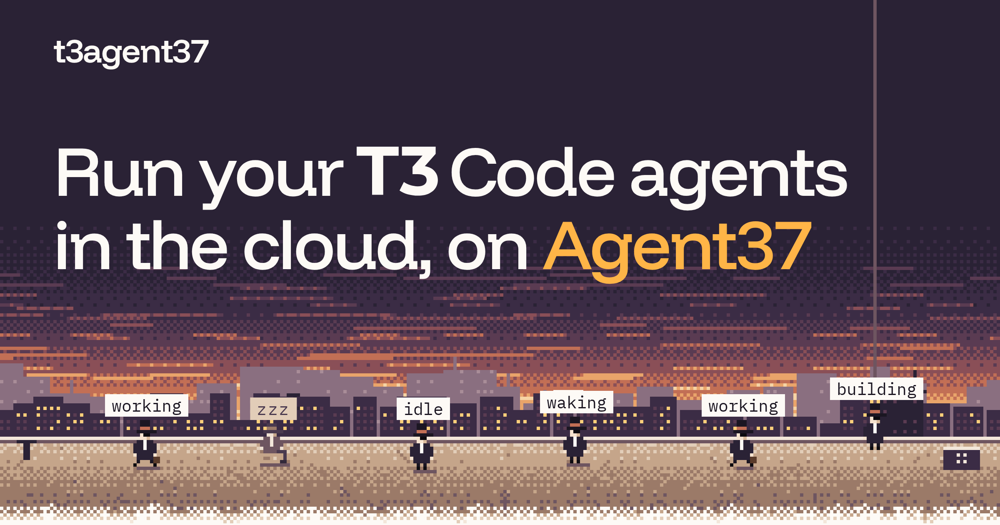

<p align="center">
  
</p>

# t3agent37

**Cloud computers for your [T3 Code](https://t3.codes) agents. They sleep when nobody's working, so you pay only while agents run.**

**[t3agent37.dagurleo.com](https://t3agent37.dagurleo.com)** · [Download for macOS](https://github.com/dagurleo/t3agent37/releases/latest) · `brew install --cask dagurleo/tap/t3agent37` · [the command](#the-command) for macOS and Linux

## The idea

[T3 Code](https://t3.codes) is an app where you chat with coding agents such as Claude Code and Codex. Usually those agents run on your laptop. Close the lid and they stop, and a big build slows everything else down.

t3agent37 gives them computers of their own in [Agent37's cloud](https://www.agent37.com), called **machines**. A machine shows up in T3 Code next to your laptop and works the same way: pick it, pick a project, chat.

The trick is that machines **sleep**:

```
  you send a message ──> the machine wakes ──> agents work ──> the last one finishes
          ^               (a few seconds)                             │
          │                                                           │ 5 quiet minutes
          └──────────── asleep: you pay for its disk only <───────────┘
                        (about $1.80 a month)
```

A machine can stay around all month for the price of its disk. You pay for computing (from $0.015 an hour) only while agents actually work. The work keeps going when your laptop is closed, and a sleeping machine wakes for T3 Code, a GitHub issue, a webhook or your phone.

## How the pieces fit

```
  your Mac                                       Agent37's cloud
  ────────                                       ───────────────
  T3 Code  ────>  t3agent37 (menu bar)  ──────>  machine "skiff"
  you chat        passes T3 Code on to             T3's server, Claude Code, Codex, gh
  here            the machine, wakes it,           your projects
                  puts it to sleep,                a watchdog that notices when
                  keeps your Agent37 key           it's idle
```

- **T3 Code doesn't know machines sleep.** It talks to t3agent37 on your Mac as if the machine were always up.
- **t3agent37 passes that on.** While a machine sleeps, t3agent37 answers T3 Code from what it saw last, so scrolling through an old chat doesn't wake the machine. Sending a message does.
- **A watchdog on the machine** notices when the agents are done and nobody is using it, then puts the machine to sleep. It runs on the machine, not on your Mac, so work finishes even when the laptop is closed. Scheduled T3 tasks wake the machine in time.
- **Each machine is an Agent37 VM:** Ubuntu with Docker, 2 to 8 vCPU, resizable at any time. It runs the same T3 version as your desktop app, and T3 Code's own "Update N machines?" dialog updates it.
- **Your Agent37 API key stays on your Mac** and is never put on a machine.

More detail: [apps/desktop/docs/architecture.md](apps/desktop/docs/architecture.md).

## Two kinds of machines

| | **Your machines** | **Temporary machines** |
|---|---|---|
| For | Day-to-day work, like a second computer | One task, a build or a test run |
| Has | Your projects, threads and sign-ins, and whatever you installed | One project as it is on your Mac right now, uncommitted changes included |
| Lasts | Until you delete it | Until the work is brought back, or 30 idle minutes |
| To make one | **New machine** in the menu bar, or `t3agent37 create` | "on a copy: …" in any T3 Code thread, or `t3agent37 run -- …` |

Most people keep one or two of the first kind and let the second kind come and go.

## Get started

You need the [T3 Code](https://t3.codes) desktop app, an [Agent37 Cloud](https://www.agent37.com) account and an API key from [Agent37's dashboard](https://www.agent37.com/dashboard/cloud/api-keys). The app needs macOS 13 or later.

1. **Install** `t3agent37.dmg` from the [latest release](https://github.com/dagurleo/t3agent37/releases/latest) (it's signed and notarized), or run `brew install --cask dagurleo/tap/t3agent37`.
2. **Click its icon** in the menu bar and paste your Agent37 API key.
3. **Create a machine.** When T3 Code asks to add it, say yes.
4. **Sign in** to Claude or Codex, and to GitHub for private repos, under **Accounts** in the machine's details. Each machine has its own sign-ins, so one machine can use another Claude subscription or a work GitHub account.
5. **Add a project** under **Projects**. Its `.env` files come with it and its dependencies get installed. Then work in T3 Code as usual.

The app checks for updates once a day and installs them. To check right away, right-click the icon and pick **Check for Updates…**.

Click a machine to open its details. They have four tabs:
- **Activity:** what its agents are doing now and what they finished, its costs and monthly limit, and its size.
- **Projects:** its projects, GitHub issues for each, and previews of the servers it runs.
- **Accounts:** who Claude, Codex and GitHub are signed in as, the plan, and how much of the usage limits is used.
- **Connections:** your phone, your other machines, the start URL and webhooks.

## Temporary machines

### "on a copy:" from any thread

Turn on **Agents may send work to copies** in Settings, or run `t3agent37 on-a-copy on`. Then, in a T3 Code thread in any project on your Mac, start your message with "on a copy:":

> on a copy: fix the flaky login test

Writing `/on-a-copy fix the flaky login test` works too. The agent in your thread then does three things:

1. It makes a temporary machine with the project exactly as it is on your Mac: the branch, commits not pushed, uncommitted changes, new files and `.env` files. The machine is ready in about a minute.
2. It hands the machine the task and gives you a link to watch the machine's thread.
3. When the work is done, it brings the changes into your files, uncommitted, and deletes the machine.

The project doesn't need to be on any machine first. It only needs to be in T3 Code on your Mac, with a GitHub origin. Your files aren't touched until the changes come back. The machine's work is also kept on a branch, `t3agent37/<machine>`, or `t3agent37-<machine>` in a repo that already has a branch named `t3agent37`.

The link opens the machine's thread read-only. To write there yourself, ask your agent to let you step in, or run `t3agent37 pair <machine>`. T3 Code then adds the machine.

### Builds and tests: `run`

In a checkout, `t3agent37 run -- cargo test` sends the files as they are to a temporary machine and runs the command there. The output shows in your terminal as it comes, the exit code is the command's, and ^C stops the command on the machine too. The machine stays for your next `run` from that checkout, which then starts in seconds instead of a minute. It goes after 30 minutes without one.

- One word after `--` runs as a shell line, for example `run -- 'cargo build && cargo test'`. Several words are a command and its arguments.
- `--timeout 30` stops the command after 30 minutes. The default is 120.

### What temporary machines start with

By default, a temporary machine starts **new**: a bare machine with T3, Claude Code, Codex and gh installed, signed in with sign-ins you save once on your Mac. Save them like this:

```sh
claude setup-token                           # opens your browser and prints a token that lasts a year
t3agent37 new-machines claude                # paste that token
t3agent37 new-machines github --from-gh      # use this Mac's gh sign-in (or paste a token)
t3agent37 new-machines codex                 # optional: an OpenAI API key for Codex
t3agent37 new-machines setup ~/bin/setup.sh  # optional: a script that runs on each new machine
t3agent37 new-machines                       # shows what's saved, never the secrets
```

Secrets are asked for hidden and kept in the app's data folder, which only you can read. Every machine t3agent37 creates gets them, temporary or not. You can save several GitHub tokens, for example your own and a fine-grained one for an organization. A temporary machine gets the first one that can push to its repo. Codex uses an API key, billed per use, because machines sharing one ChatGPT login could sign each other out. Without a key, Codex starts signed out.

A temporary machine can also start as a copy of a **base**: a machine you set up once with tools that are slow to install, then kept stopped (about $1.80 a month). Copies are slower: a 3 GB base took 94 s, a new machine 46 s. A base is only worth it when your setup takes longer than that.

```sh
t3agent37 copy skiff base --size default   # a machine to become the base (or create one and set it up)
t3agent37 sign-in base claude --token      # give its Claude a token that lasts a year (paste it)
t3agent37 base base on                     # make it a base: it's stopped, and nothing wakes it
t3agent37 new-machines start base          # temporary machines now start as copies of it
t3agent37 base base refresh                # now and then: update its projects and tools, then stop it
t3agent37 new-machines start new           # back to new machines
```

`--new` or `--base <name>` on `spawn` and `run` picks one way for one time. Keep a base small, because copies take longer the more its disk holds. A base needs no projects: temporary machines clone theirs.

### Good to know

- A temporary machine with nothing running for 30 minutes has its work saved to its branch and is deleted. After 24 hours it's deleted no matter what, with its work saved first.
- Underneath, an agent calls `spawn_machine`, or you run `t3agent37 spawn`. Either one makes the machine and sends the checkout. The agent hands it work with T3's `delegate_task`, and the result comes back to the agent's own thread. Then `collect_machine` or `t3agent37 collect <machine>` brings the work back. `--no-apply` gives you only the branch, and `--keep` keeps the machine.
- Agents can spawn temporary machines only while the Settings switch is on. Bases, saved sign-ins, `run` and the switch itself are yours alone: agents can't touch them.

## Agents that start on their own

### GitHub issues to pull requests (a prototype)

Label an issue and get a pull request back.

1. In a machine's details, under **Projects**, flip **issues** next to a project. Pick the label (`agent` unless you change it), the model, and how hard it thinks. The machine needs GitHub signed in, with admin rights on the repo so it can add the webhook.
2. Label an issue. GitHub tells the machine, and the machine wakes if it was asleep.
3. The machine checks that whoever added the label can push to the repo. It comments on the issue and starts a thread on it, in its own worktree on the branch `issue-<number>`.
4. The agent pushes the branch and opens a pull request.

Then work with the agent on the pull request, as you would with a colleague:
- **Reviews** from people who can push go to the agent.
- **Comments** go to it when a line starts with `/agent`, for example `/agent rename the flag too`. Other comments are left alone.
- **Failing CI** on the latest commit sends it the failed checks.

The machine reacts 👀 to what it passes on. The agent pushes fixes to the same branch and replies once. To keep costs from running away, a pull request gets at most 6 rounds a day, and CI at most 3 fixes in a row.

Only labels from people with push access count, but anyone can write an issue's text. On a public repo, read an issue before you label it.

### Webhooks that wake

T3 Code's scheduled tasks can run on a webhook, so a Sentry alert, a Linear issue or a Zapier step can start an agent. T3's own webhook URL can't wake a sleeping machine, though. So the machine's details list its webhook tasks under **webhooks**, each with **Copy URL**: an address that wakes the machine first, then hands the delivery to T3. Treat that address like a password, and give the task a signing secret for anything that matters.

### The start URL

The start URL starts threads with plain web requests, so Grok, a phone shortcut or a script can use it. Turn on **start url** under **Connections**, then click **Copy URL**:

| Request | What it does |
|---|---|
| `GET <url>` | Lists the machine's projects and models, and how to call it |
| `POST <url>` with `{"project": "Tantalum", "prompt": "Fix the flaky login test"}` | Starts a thread and answers `201` with a `threadUrl`. Optional fields: `title`, `model`, `effort`, and `"worktree": true` |
| `GET <threadUrl>` | Gives the thread's status, and the agent's reply once it's done |
| `POST <threadUrl>` with `{"prompt": "Also update the README"}` | Sends a follow-up |

- To keep the token out of the address, click **Copy address** and **Copy token**, and send `Authorization: Bearer <token>`.
- Threads run in full-access mode with the project's default model, or Claude Opus 5.5 at high effort if it has none. The URL takes at most 30 starts and follow-ups an hour, and it can read only the threads it started.
- Anyone with the token can start agents on that machine as you. **Replace URL** retires the old one at once.
- For Grok, give it the address and the token, and tell it to call them with `curl`. Don't give it the wake link, which only wakes the machine.

## Machines that work together

You can let one machine's agents use another machine, for example to "run the benchmarks on faktor". In a machine's details, under **Connections → other machines**, pick how far its agents may go on each of your other machines:

| Access | Its agents may |
|---|---|
| **off** | do nothing there |
| **read** | read its threads |
| **ask** | start threads that ask you before each change |
| **edits** | edit files, and ask before running commands |
| **auto** | work in T3's auto mode |
| **full** | run anything |

From a terminal: `t3agent37 link skiff faktor --access full`, `t3agent37 links` and `t3agent37 unlink skiff faktor`.

An agent on skiff finds faktor and hands it work with T3's `delegate_task`. faktor wakes and does the work in a thread of its own, which you can see in T3 Code, and the result comes back to skiff's thread. Links go one way: faktor can't use skiff unless you allow that too. Only you can change links, never an agent.

## More things it does

### Your phone

1. In the machine's details, under **Connections**, turn on **T3 Connect**.
2. In the T3 Code phone app, add the machine under **Settings → Environments → T3 Connect**.
3. T3 Connect can't wake a sleeping machine, so click **Copy link** next to "Wake link" and put that link on your phone's home screen. Tap it, wait for "awake", then use the machine.

The wake link only wakes the machine. Using it still takes your T3 sign-in. **Replace link** retires the old link. T3's free plan allows 3 machines on T3 Connect.

### Previews

A dev server an agent starts on a machine opens in your browser at `http://localhost:<port>`. Servers are listed under **previews** in the **Projects** tab, and **Open another port…** opens any other port. Opening the page wakes a sleeping machine, but a tab left open doesn't keep it awake.

### Copies

Pick ⋯ → **Make a copy…**, or run `t3agent37 copy skiff skiff2 --size huge`. You get a new machine with the other one's disk as it is now: projects, files, work not pushed, threads, sign-ins and tools. The copy gets its own T3 identity, so T3 Code adds it as a new machine. T3 Connect, GitHub issues, the start URL and links to other machines stay with the original. A copy takes a few minutes, and the original isn't touched.

### Throwaway machines

Give a machine a time to go: **delete it after** in the new machine form, or `--delete-after 2h` on `create` and `copy`. Later, `t3agent37 delete-after raven 2h` sets one, and `delete-after raven never` keeps the machine. It's never deleted while its agents are working: it waits for them. You hear about it 10 minutes before. This needs t3agent37 running on your Mac. If it wasn't running at that time, the machine goes the next time t3agent37 starts.

### Benchmarks on several sizes

`t3agent37 bench skiff --sizes small,huge --project Tantalum -- cargo build --release` copies skiff at each size and runs the command on all of them at once. It prints the times side by side, then deletes the copies.

### What a machine is doing

The **Activity** tab shows each thread its agents are working on: the project, the model, how long it has run, whether it waits for your approval, the command it's running, and what the agent last said. It also shows what woke the machine, its CPU, memory and disk with the busiest processes, and what finished in the last day. Click a thread to open it in T3 Code.

### Costs and spending limits

You see the costs of each machine for today and this month, what each project cost, and your Agent37 wallet. Set a **monthly limit** for a machine under **Activity**, or one for all machines together in **Settings → spending** (`t3agent37 limit skiff 10`, `t3agent37 limit 50`). You get a notification at 80%. At the limit, the machine is **stopped**, not just put to sleep, so nothing can wake it (not GitHub, a webhook or another machine) until you raise the limit or the month ends. Agents can see limits but never change them.

### Other accounts and GitHub tokens

- **Other account**, next to **Sign in** (or **Switch account** once signed in), opens the sign-in in a private browser window. That way a machine can use another Claude subscription or GitHub account than your browser's. Safari can't open a private window for another app, so there the page opens as usual.
- **Some repos only…**, next to GitHub, opens GitHub's page for a fine-grained token with the details filled in. Pick the repos, generate the token and paste it in. The machine's gh then reaches only those repos. One token covers one owner: your account or one organization. With such a token, feedback on pull requests sees CI from GitHub Actions only, not other checks.

### Env files

A project's `.env` files go to the machine when the project is added. If you change one on your Mac, click **Copy again** next to the project's **env** line, or run `t3agent37 env skiff Tantalum --copy`. The line lists the files and their variable names, never the values.

### A second computer

Install t3agent37 on another computer with the same Agent37 API key. Machines made elsewhere show under **on your agent37 account**, and **Add here** gives this computer a sign-in of its own to one. Both computers then share the machine, with its threads, projects, sign-ins and settings. Keep t3agent37 up to date on both.

### Agents on your Mac

t3agent37 runs an MCP server, so Claude Code and Codex on your Mac can list your machines, wake them, copy them, open their ports and send work to temporary machines. A few things stay with you alone: spending limits, links between machines, bases, saved sign-ins and `run`.

### Notifications

You get a notification when a machine's agents finish, when your Agent37 wallet runs low, and when a machine stays awake for hours.

## The command

The `t3agent37` command does everything the menu bar does, from a terminal, with tab completion. `t3agent37 help` lists all of it.

```sh
t3agent37 list                            # the machines, what each is doing, and the costs
t3agent37 details skiff                   # its agents, activity, projects and costs
t3agent37 create raven --delete-after 2h  # a machine that goes in 2 hours (T3 Code asks to add it)
t3agent37 wake skiff                      # also sleep, keep-awake skiff 30, auto-sleep skiff off
t3agent37 add-project skiff Tantalum      # one of `t3agent37 projects`
t3agent37 sign-in skiff github            # in your browser; the GitHub code shows here
t3agent37 run -- cargo test               # in a checkout: on a temporary machine
t3agent37 copy skiff bench --size huge    # a copy of skiff
t3agent37 link skiff faktor --access full # skiff's agents may use faktor
t3agent37 limit skiff 10                  # skiff stops at $10 this month
t3agent37 issues skiff Tantalum on --model claude-opus-5-5 --effort high
t3agent37 start-url skiff on              # prints the URL, which is a secret
```

A machine is its name or its id. `list`, `details` and `projects` take `--json`. `details` never wakes a machine and leaves secrets out.

**To install it:**

```sh
curl -fsSL https://raw.githubusercontent.com/dagurleo/t3agent37/main/install.sh | sh   # to ~/.local/bin; `t3agent37 update` updates it
brew install --formula dagurleo/tap/t3agent37                                          # or Homebrew, on macOS or Linux
```

The Homebrew cask links the command for you. With the app installed some other way, run `ln -s /Applications/t3agent37.app/Contents/MacOS/t3agent37 ~/.local/bin/t3agent37`.

**Completions:** `t3agent37 completions zsh > "${fpath[1]}/_t3agent37"` for zsh, `source <(t3agent37 completions bash)` in `~/.bashrc`, or `t3agent37 completions fish > ~/.config/fish/completions/t3agent37.fish`. Homebrew's formula installs them.

**Without the app**, on Linux or on a Mac you'd rather not run it on, `t3agent37 serve` does the app's job without the panel:

```sh
t3agent37 setup              # your Agent37 API key, asked for hidden and kept on this computer
t3agent37 serve --install    # runs now and at every login (launchd or systemd; or `brew services start t3agent37`)
t3agent37 create raven
```

Its log is `~/Library/Logs/t3agent37.log` on macOS and `journalctl --user -u t3agent37` on Linux. Run either the app or `serve`, not both. Either way, T3 Code's desktop app must be on the same computer.

## Pricing, roughly

Agent37 bills per minute from your prepaid Agent37 wallet. Asleep, a machine costs only its 20 GB disk: about $1.80 a month. Awake, it costs the rate for its size:

| size | VM | per hour awake |
|---|---|---|
| small | 2 vCPU · 4 GB | $0.015 |
| default | 4 vCPU · 8 GB | $0.030 |
| large | 4 vCPU · 16 GB | $0.049 |
| xlarge | 4 vCPU · 32 GB | $0.088 |
| huge | 8 vCPU · 64 GB | $0.175 |

For example, a default machine awake 3 hours a day costs about $2.70 a month in computing, plus its disk.

## Settings

- **Notifications:** wallet running low, hours awake, agents finishing.
- **Projects:** whether projects are set up (their dependencies installed) when they're added.
- **Agents may send work to copies:** the switch for "on a copy".
- **New machines:** whether temporary machines start new or from a base, and what new machines are signed in with.
- **Spending:** a monthly limit on all machines together.
- **Look:** the panel's size (Standard, Large or Huge; ⌘+ and ⌘− change it too) and an animated rooftop instead of the still skyline.

## Security

- **Your Agent37 API key** stays on your Mac, readable by you only. It's never copied to a machine.
- **Wake links** are secret URLs. Anyone with one can wake that machine, but not use it.
- **A start URL or a webhook address** lets whoever has it start agents on that machine. Keep them like passwords, and replace them if they leak.
- **A link between machines** lets one machine's agents act on the other. An agent misled on one machine, by a GitHub issue's text for example, could reach the other. Give a machine that works on public issues no links, or narrow ones.

To report a vulnerability, see [SECURITY.md](SECURITY.md).

## Status

t3agent37 is young. It's used every day on its author's machines, and the GitHub issues feature is still a prototype. [STATUS.md](STATUS.md) lists what was tested live on Agent37, what hasn't been tried yet, and the known gaps.

## Where it came from

t3agent37 began in November 2026 as a fork of [t3boat](https://github.com/paukraft/t3boat) by Pau Kraft (MIT), which gives T3 Code machines on [Boat](https://boat.dev) that sleep when nobody is working. It was forked to run on Agent37 Cloud.

- **From t3boat:** the idea and its core, the proxy that keeps T3 Code working while a machine sleeps (`apps/desktop/src/proxy`, changed by two lines), with its spec in `apps/desktop/docs/t3-protocol.md`. Also t3boat's first features: creating and sizing machines, adding projects, agent sign-ins, T3 Connect, keep-awake, scheduled work, costs, linked environments for local agents and the MCP server.
- **Rebuilt for Agent37:** everything that talks to the cloud (`agent37.rs` replaces `boat.rs`), and with it how a machine boots, decides to sleep and reads its costs. Agent37 VMs differ from Boat sandboxes in ways that mattered ([Agent37 behaviors](CONTRIBUTING.md#agent37-behaviors-verified-live)).
- **Added since:** a native GPUI panel in place of a webview, the `t3agent37` command, GitHub issues to pull requests, webhooks that wake, the start URL and the wake link, machines that work together, copies, temporary and throwaway machines, sign-ins per machine, spending limits, previews, and more. The whole story is in [CONTRIBUTING.md](CONTRIBUTING.md#history).

## Contributing

[CONTRIBUTING.md](CONTRIBUTING.md) explains how to build, test and release, maps the repo, and lists the Agent37 and T3 Code behaviors that were verified live. Read it before changing anything. Coding agents get it through [CLAUDE.md](CLAUDE.md). To build the app yourself, see [Build, install, test](CONTRIBUTING.md#build-install-test-macos).

## License

[MIT](LICENSE), as t3boat. Not affiliated with or endorsed by T3 Code, Agent37 or Boat.
